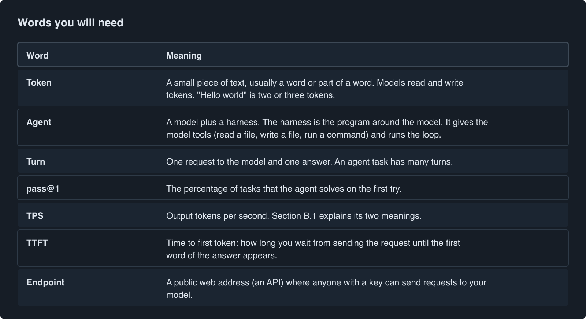
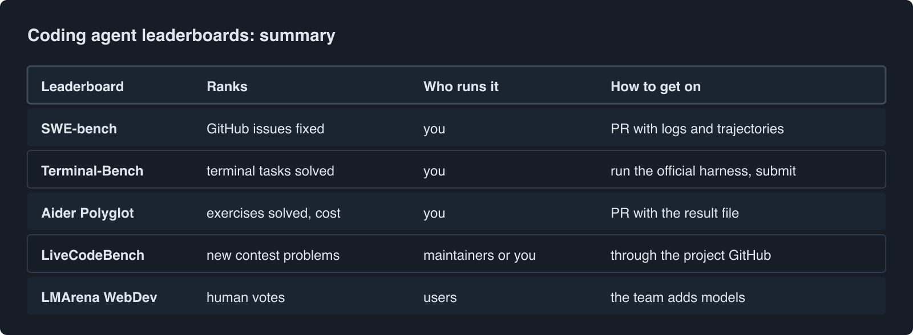
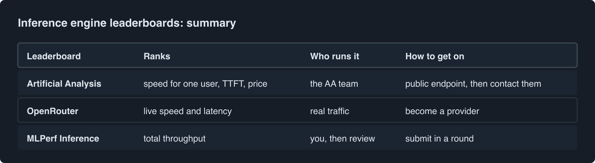
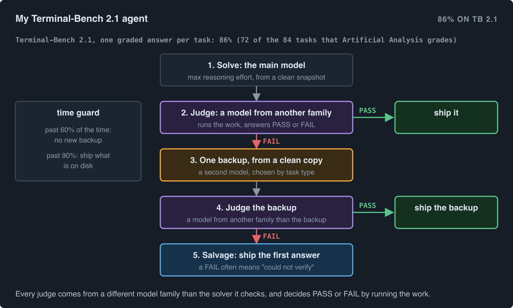
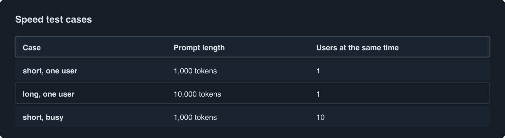
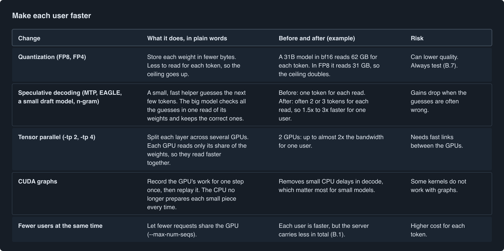
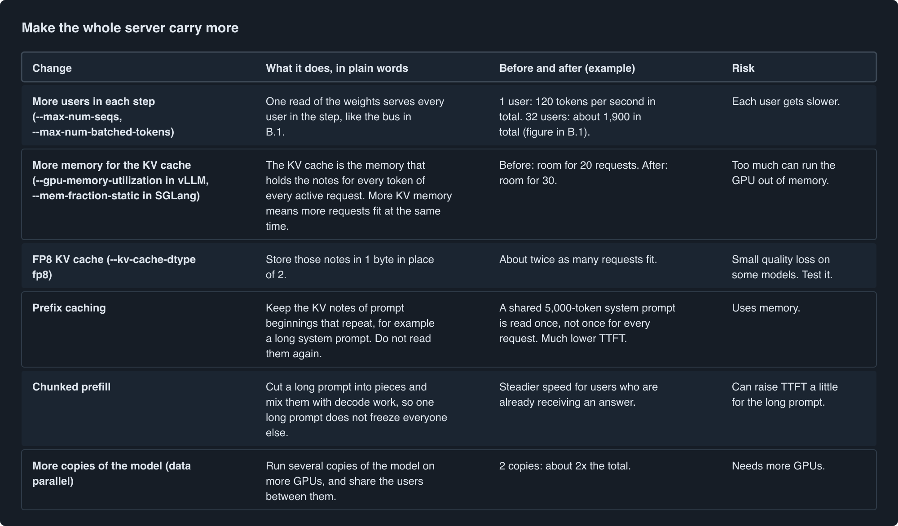

# Get on the leaderboards: benchmark coding agents and increase LLM inference TPS

*This article uses simple English, close to ASD-STE100 Simplified Technical English (about 80%). Each technical word gets a short explanation in brackets the first time it occurs. Technical names and commands stay as they are.*

This article joins two topics that people often mix up.

- **How good is a coding agent?** This is a question about quality. You answer it with agent benchmarks such as SWE-bench and Terminal-Bench. The answer depends on the model, the agent program around it, and a few server settings.
- **How fast does an LLM server make tokens?** This is a question about speed, measured in **TPS** (tokens per second). The answer depends on the GPU, the serving engine (for example vLLM or SGLang) and its settings. It has nothing special to do with agents. The same TPS matters for a chat app, a document summary job or a coding agent.

Each topic has its own leaderboards. So the article starts with them: first the coding agent leaderboards, then the inference engine leaderboards, with how to get on each one. Then **Part A** teaches how to benchmark a coding agent, and **Part B** teaches how to measure and increase inference TPS. **Part C** shows the one place where the two topics meet.


The rules of each leaderboard change often. This article describes them as they were in October 2026. Before you submit, read the current rules on each site.

## Words you will need



---

# Coding agent leaderboards

## What does a task look like?

Each benchmark is a list of **tasks**. A task gives the agent a job and a place to work. When the agent says "done", an automatic check decides if the job is really done. The agent never sees this check.

Here is one short example in the style of each benchmark. They are simplified, so you can read them quickly.

**SWE-bench: fix a bug in a real project.**

```
The agent gets:  a copy of a Python project, and this bug report:
                 "slugify('Hello  World') returns 'hello--world'.
                  It should return 'hello-world'."
The agent does:  finds slugify() in utils/text.py, and changes it
                 so that two spaces become one dash.
The check:       the tests from the real fix must pass, and all the
                 old tests of the project must still pass.
```

**Terminal-Bench: do a job in a terminal.**

```
The agent gets:  a terminal inside a container, and this instruction:
                 "The web server in /app does not start.
                  Make it answer on port 8080."
The agent does:  reads the error log, installs a missing package,
                 changes the port in the config file, starts the server.
The check:       a script asks localhost:8080 for a page and expects an answer.
```

**Aider Polyglot: finish an exercise in one of six languages.**

```
The agent gets:  a Rust file with an empty function, and this instruction:
                 "is_leap_year(year): a year is a leap year if it divides by 4,
                  except when it divides by 100, unless it also divides by 400."
The agent does:  writes the function.
The check:       the exercise's tests. If they fail, the model sees the
                 errors and gets one more try.
```

**LiveCodeBench: solve a new contest problem.**

```
The agent gets:  "Read a list of numbers. Print the length of the longest
                  run of equal numbers next to each other.
                  Example: 1 1 2 2 2 3  ->  3"
The agent does:  writes a program.
The check:       hidden inputs, each with a known answer and a time limit.
```

**LMArena WebDev: build something a person likes more.**

```
A user asks:     "Make a to-do list web page with a dark mode button."
Two hidden models each build a page. The user tries both pages.
The check:       the user votes for the better page.
```

#### How the score is counted

A task counts as **solved** only when its check passes completely. Half a fix scores 0. For example, if the agent solves 320 of the 500 SWE-bench Verified tasks on its first try, its score is 320 / 500 = 64% (this is **pass@1**).


So these leaderboards ask one question: **how many tasks does this agent solve?** They measure quality. The speed of your server does not appear on them, although it can change your score on long tasks (Part C).

On most of them, you run the benchmark yourself and send the results with all the logs. The leaderboard team checks the logs before your score appears. Think of a race where you time yourself, and then send the video so that the officials can check it. LMArena is different: there, real users vote. To prepare for any of these boards, read Part A.

### SWE-bench

**What it ranks.** [SWE-bench](https://www.swebench.com) gives the agent real bug reports from GitHub Python projects. The agent must change the code so that the project's own tests pass. The score is the percentage of bugs it fixes. The best-known list is **SWE-bench Verified**: 500 tasks that people checked by hand to make sure that each one is fair.

**Who runs it.** You run it, then you submit.

**How to get on.** Open a pull request (a request to add your files) to the SWE-bench experiments repository. Include the agent's answers (the predictions), the evaluation logs, the full **trajectories** (the record of every step the agent took) and a short file that describes the model and the harness. Read the current rules first, because they change.

### Terminal-Bench

**What it ranks.** [Terminal-Bench](https://www.tbench.ai) gives the agent jobs in a real terminal: build a program, set up a server, fix a broken script. Each task runs in its own **container** (a small, sealed computer inside your computer) and has its own tests. Version 2.0 has 89 tasks.

**Who runs it.** You run it with the official harness, then you submit.

**How to get on.** Do a full run with the official harness, then open a pull request that adds your run logs to the Terminal-Bench logs repository on Hugging Face (see the Terminal-Bench submission guide).

**Note.** Terminal-Bench tasks are long, and each one has a time limit. A slow server fails tasks that it could solve. So speed (Part B) has a big effect on this score. Part C explains why.

### Aider Polyglot

**What it ranks.** The [Aider leaderboard](https://aider.chat/docs/leaderboards/) asks the model to solve 225 programming exercises in six languages (C++, Go, Java, JavaScript, Python and Rust). It also shows how much the full run cost.

**Who runs it.** You run the Aider benchmark, then you open a pull request to the Aider repository with the result file.

### LiveCodeBench

**What it ranks.** [LiveCodeBench](https://livecodebench.github.io) uses new contest problems from LeetCode, AtCoder and Codeforces. You can choose only problems that were published after the model was trained. So the model cannot have seen the answers during its training. (When a model has seen benchmark answers during training, its score is too high. This is called **contamination**.)

**Who runs it.** The maintainers evaluate models. You can also run the open code and send results through the project's GitHub.

### LMArena WebDev

**What it ranks.** [LMArena](https://lmarena.ai) shows a user two answers from two hidden models. The user votes for the better one. The WebDev board uses web development tasks. The votes become a score, the same way chess ratings work.

**Who runs it.** Real users vote. The LMArena team decides which models to add.

### Summary



---

# Inference engine leaderboards


These leaderboards ask a different question: **how fast does this server answer?** They measure the inference engine (for example vLLM or SGLang), the GPUs and the settings, for any kind of request. They do not ask whether the answers are good at coding.

Each one gets its numbers in its own way:

- **Artificial Analysis measures you.** Their team sends requests to your public endpoint and times the answers with their own stopwatch. You cannot send your own numbers.
- **OpenRouter uses real traffic.** The speed comes from the requests of real users, all day.
- **MLPerf Inference checks your run.** You run the official test yourself, and the results are reviewed before they are published.

To prepare for any of these boards, read Part B.

### Artificial Analysis

**What it ranks.** [Artificial Analysis](https://artificialanalysis.ai) compares models and the companies that serve them (the **providers**). For each provider of each model, it shows the output speed (TPS for one user), TTFT, the total time for one answer, and the price. It also publishes quality scores from its own tests, but its provider pages are about speed and price.

**Who runs it.** They measure you. They send test requests to public endpoints many times a day and show the median (the middle value).

**How to get on.**

1. Serve the model on a public API endpoint that paying users can use.
2. Contact Artificial Analysis and ask them to add your endpoint.
3. They measure it from their own computers.

**How to prepare.** Their numbers come from many measurements over time, not from one good moment. So:

- Before you contact them, measure your endpoint with your own copy of their method (B.4).
- Keep spare capacity. If other customers fill your GPUs during their test, your measured speed drops.
- Do not change the server settings without a test. One untested change can lower your speed for days.

### OpenRouter

**What it ranks.** [OpenRouter](https://openrouter.ai) is a single API that sends each request to one of many providers. Its model pages show the live speed and latency (waiting time) of each provider, measured from real traffic. Its rankings also show which models people use most.

**How to get on.** Become a provider on OpenRouter. Then real traffic measures you. A fast and reliable provider gets more requests.

### MLPerf Inference

**What it ranks.** [MLPerf Inference](https://mlcommons.org/benchmarks/inference-datacenter/) is run by MLCommons, an industry group. It compares complete systems (the hardware plus the software) on fixed models, including large language models. It reports throughput (the total tokens per second of the whole server) in two main scenarios: **Offline** (as fast as possible, with no limit on waiting time) and **Server** (as fast as possible while each request still meets a latency limit).

**Who runs it.** You run it with the official rules, and other submitters and MLCommons review the results before they are published. Results come out in fixed rounds, a few times a year. Submitters are usually member organisations of MLCommons. Read the current rules to see what is needed.

**Note.** MLPerf is mostly for hardware and system companies. It is the board where total throughput (B.1) matters most.

### Summary



---

# Part A: My coding agent on Terminal-Bench 2.1

**Score: 86%.** My agent solved 72 of the 84 Terminal-Bench 2.1 tasks that Artificial Analysis grades (85.7%), in one full run, with one graded answer for each task (pass@1).



---

# Part B: Measure and increase LLM inference TPS

Part B is about the server. Forget agents for now. Everything here is the same for any program that sends requests to an LLM.

## B.1 What TPS means, and why there are two kinds

**TPS** is tokens per second: how fast text comes out of the model. But people use it for two different things.


- **Speed for each user** (also called output speed). How fast the words appear for one person. This is what a user feels, and what Artificial Analysis shows.
- **Total throughput** (the speed of the whole server). All tokens from all users added together. This is what decides the cost: more tokens per GPU per hour means cheaper tokens. MLPerf measures this.

Think of a bus. With one passenger, the bus drives fast and stops only once. With forty passengers, it stops often, so each passenger arrives later. But the bus carries forty people on one trip. One passenger is "speed for each user". Forty passengers is "total throughput".

The figure shows this with example numbers. One user gets 120 tokens per second. With 128 users, each one gets only 25, but the server makes 3,200 in total. **So a TPS number means nothing unless you say which kind it is and how many users were active.**

Two more timing words:

- **TTFT** (time to first token): the wait before the first word. It includes the time in the queue and the time to read the prompt.
- **ITL** (inter-token latency) or **TPOT** (time per output token): the gap between two words. It is 1 divided by the speed for each user. For example, 50 TPS means a gap of 20 milliseconds.

## B.2 Prefill and decode: reading and writing

A model works in two phases.

- **Prefill** (reading): the model reads the whole prompt in one go. All the prompt tokens are processed together, so the GPU's calculators are busy. Prefill decides most of the TTFT.
- **Decode** (writing): the model writes the answer one token at a time. For each new token, the GPU must read **all** of the model's weights (the learned numbers) from memory again, but it does only a little maths with them.

Think of a cook who must walk to the pantry and carry the whole cookbook back for every single word of the recipe they write. The walking, not the cooking, takes the time. In decode, the "walking" is reading the weights from memory. So decode speed depends mostly on **memory bandwidth** (how many bytes per second the GPU can read from its memory).

## B.3 The ceiling: the fastest one user can go

Because decode reads all the weights for every token, you can calculate the top speed for one user before you measure anything:

```
top speed for one user  =  memory bandwidth  /  bytes of weights read for each token
```


**Example.** A model with 31 billion weights, stored in bf16 (2 bytes for each weight), has 62 GB of weights. A GPU that can read about 8 TB (8,000 GB) per second can read those 62 GB about 129 times each second. So one user can never get more than about 129 tokens per second from this setup, unless you change the method (B.6).

For a **mixture-of-experts** (MoE) model, only some parts of the model (the "experts") are used for each token. Use only the **active** weights in the formula, which makes the ceiling much higher.

Why calculate this first? Because it tells you where you are:

- If you measure 60 TPS and the ceiling is 129, the server wastes half its time somewhere. Settings can help a lot.
- If you measure 125 TPS, you are near the limit. Only a change of method (fewer bytes, or more than one token for each read) can help.
- If you measure 300 TPS, your measurement is wrong (see B.5).

## B.4 Measure TPS the way the leaderboards do

Build your own small copy of the leaderboard method. Then you know your number before they publish it.

1. **Use fixed prompts.** Use the same prompt lengths every time, for example 1,000 input tokens and 10,000 input tokens. Freeze this set and give it a version number.
2. **Fix the output length.** Ask for the same number of output tokens every time. A short answer and a long answer give different speeds.
3. **Use streaming.** With streaming, the server sends each token as soon as it is ready. Measure TTFT at the first token. Measure the speed from the first token to the last.
4. **Test separate cases.** Measure one user at a time. Then measure with several users at the same time. Never mix them in one number.
5. **Report the median.** Send at least 30 requests for each case, and report the middle value. Also report p99 (the slowest 1%), which shows the bad moments.

Both main engines include a tool for this. For example, with vLLM:

```bash
vllm bench serve --model <model> --dataset-name random \
  --random-input-len 1000 --random-output-len 500 \
  --num-prompts 100 --max-concurrency 1 --ignore-eos
```

- `--random-input-len 1000 --random-output-len 500`: fixed prompt and answer lengths.
- `--max-concurrency 1`: one user at a time. Run it again with 8, 32 and so on.
- `--ignore-eos`: the model must write all 500 tokens, even if it wants to stop early. This keeps the output length fixed.

SGLang has the same kind of tool: `python -m sglang.bench_serving` with similar flags. Both print TTFT, ITL, and the output throughput.

Example of the cases from one of my harnesses:



## B.5 Count the tokens yourself

A speed number is only as good as the token count. When you measure through an API, especially a gateway (a service that forwards your request to a provider), check these:

- **Count the tokens in the stream yourself.** Do not trust the token count that each provider reports. For example, in one of my tests, two identical requests through one gateway reported 445 and 5,000 output tokens.
- **Read every reasoning field.** Some gateways send the reasoning in `reasoning` or `reasoning_details`, not in `reasoning_content`. If you count only one field, you miss tokens, or count them twice. In one of my tests, this mistake gave a speed of 15,000 tokens per second.
- **Compare with the ceiling.** A number above the ceiling in B.3 is a bug in the measurement, not a fast server.

## B.6 Increase TPS

Some changes make each user faster. Others make the whole server carry more. Know which one you need before you change anything.

### Make each user faster



**Why speculative decoding works so well on code.** Code repeats itself: variable names, file paths, lines from earlier in the file. Guesses are easy, so most of them are accepted. **N-gram drafting** needs no extra model at all. It looks for the last few tokens earlier in the prompt and guesses that the text continues the same way, which is very good for edits that copy existing text.

### Make the whole server carry more



## B.7 Check quality after every speed change

Every speed change can change the output, sometimes badly. A server that is fast and wrong is worse than a slow one, because it looks like a win.

For example: before, the server answers "What is 17 x 23?" with "391". After a new quantization setting, it is 30% faster and answers "381". Without a check, you would publish the faster number.

After each change:

1. Send a **correctness gate**: a few short fixed prompts with one known correct answer each. If any answer is wrong, stop.
2. Run a small quality test, for example part of a standard benchmark.
3. Compare with the result from before the change.

---

# Part C: Where the two topics meet

Speed and quality are separate measurements. But for coding agents, speed changes the quality score. Here is why.


An agent does many turns, and each turn pays the waiting time again:

```
task time  =  for every turn: (TTFT + output tokens / speed for one user)  +  time running tools
```

**Example.** A task has 30 turns. Each turn writes 400 tokens and runs tools for 3 seconds.

- Before: TTFT 1.5 seconds and 60 tokens per second. The task takes about 335 seconds.
- After (prefix caching cuts TTFT, speculative decoding and FP8 raise the speed): TTFT 0.4 seconds and 150 tokens per second. The same task takes about 182 seconds.

Now remember that agent benchmarks have **time limits**, and the harness grades whatever is on disk when the clock runs out. A faster server leaves time for one more attempt, one more check, or one refinement pass. So the same agent gets a higher score.

Two speed changes from Part B help agents the most:

- **Prefix caching.** Each turn sends the whole conversation again, and most of it is the same as last turn. With prefix caching, the server reuses the notes of the earlier turns. In one of my load tests, 96.7% of the input tokens came from the cache. So TTFT stays low even when the conversation gets long.
- **Speculative decoding.** Agents write code, and code is easy to guess (B.6).

But keep the two reports separate. An inference engine leaderboard does not tell you if the agent is good. A coding agent leaderboard does not tell you if the server is fast. Publish both, and say which is which.

---

# Checklist before you submit

**For a coding agent leaderboard:**

1. Run the official harness, with one graded answer for each task.
2. Report the score out of 89 and out of the 84 tasks that Artificial Analysis grades.
3. Submit the logs the way the leaderboard asks.

**For an inference engine leaderboard:**

1. Calculate the ceiling for one user (B.3).
2. Measure with fixed prompts, fixed output lengths and streaming. Report the median and p99.
3. Say which TPS you mean (for each user, or total) and how many users were active.
4. Count tokens from the stream, and read every reasoning field.
5. Make sure no number is above the ceiling.
6. Run the correctness gate after every speed change.
7. For Artificial Analysis, which measures you itself, keep spare capacity and do not change settings without a test.

# Summary

Start from the leaderboard you want, because it tells you what to measure and who measures it. For coding agent leaderboards, my agent scored 86% on Terminal-Bench 2.1 (architecture in Part A). For inference engine leaderboards, know the two kinds of TPS, calculate the ceiling, measure the way the board does, and check quality after every speed change. The two topics meet in agent task time: a faster server finishes more agent tasks inside the time limit.
