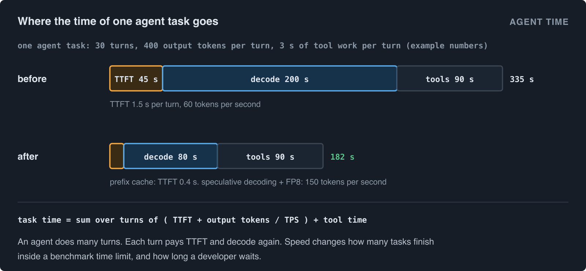
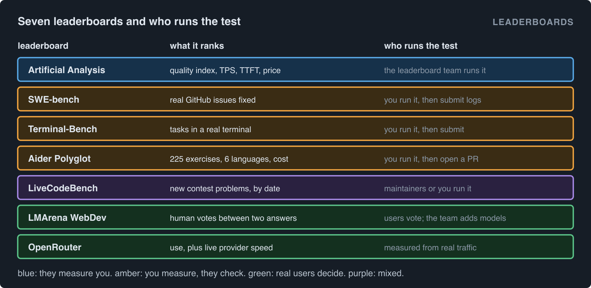

# Benchmark coding agents, increase TPS, and get on the leaderboards

*This article uses the writing rules of ASD-STE100 Simplified Technical English, at approximately 80% conformance. The sentences are short and in the active voice. Each term has one meaning. Technical names and commands stay as they are.*

A coding agent is a model that writes and changes code in many steps. It reads files, runs commands, reads the results and tries again. To show that an agent is good, you must measure two things: **quality** and **speed**. Then you can send your results to public **leaderboards**.

This article tells you how to do the three tasks:

1. Measure the quality of a coding agent.
2. Measure and increase its speed, in tokens per second (TPS).
3. Get your model or your endpoint onto the main leaderboards.

The rules of each leaderboard change often. This article gives the procedure as it was in October 2026. Before you submit, read the current rules on each site.

## Terms

| Term | Meaning |
|---|---|
| **Agent** | A model plus a **harness**. The harness gives the model tools (read file, write file, run command) and controls the loop. |
| **Turn** | One request to the model and one answer. An agent task has many turns. |
| **TTFT** | Time to first token. The time from the request to the first token of the answer. |
| **TPS** | Output tokens per second, measured after the first token. Also called output speed. |
| **pass@1** | The percentage of tasks that the agent solves on the first attempt. |
| **Endpoint** | A public API address that serves a model. |
| **Harness lock** | You keep the harness the same when you compare models. Then the difference comes from the model. |

## 1. Why speed is important for agents

An agent does many turns for one task. Each turn pays the TTFT and the decode time again:

```
task time = sum over turns of ( TTFT + output tokens / TPS ) + tool time
```



Example: a task has 30 turns. Each turn writes 400 tokens and runs tools for 3 seconds. At a TTFT of 1.5 s and 60 TPS, the task takes 335 seconds. At a TTFT of 0.4 s and 150 TPS, the same task takes 182 seconds.

Speed also changes the quality score. Agent benchmarks have time limits. In one of my Terminal-Bench runs, more than half of the 89 tasks stopped at the 900-second limit. A faster model finishes more tasks inside the limit. Thus speed and quality are not separate.

## 2. Measure the quality of a coding agent

### 2.1 Select the correct benchmark

Each benchmark measures a different skill. Use more than one.

| Benchmark | What it measures | Size |
|---|---|---|
| **SWE-bench Verified** | The agent fixes real issues from GitHub Python projects. The tests of the project decide if the fix is correct. | 500 tasks that people examined |
| **Terminal-Bench** | The agent does tasks in a real terminal: build software, configure systems, fix scripts. | 89 tasks in version 2.0 |
| **Aider Polyglot** | The model edits code to solve exercises in C++, Go, Java, JavaScript, Python and Rust. | 225 exercises |
| **LiveCodeBench** | The model solves new contest problems. It uses only problems from after the training date of the model. | Changes with time |

**Contamination.** A model can see benchmark answers during training. Then its score is too high. LiveCodeBench prevents this with dates. SWE-bench Verified and other fixed sets cannot prevent it. Thus also test with tasks that are not public.

### 2.2 Lock the harness

The same model can give very different scores in different harnesses. When you compare models, use one harness for all of them. Examples of harnesses are SWE-agent, mini-SWE-agent, OpenHands and Terminus, the reference agent of Terminal-Bench.

When you compare harnesses, keep the model the same.

### 2.3 Configure the server for agents

Many low agent scores come from server settings, not from the model. Before you run a benchmark, examine these settings:

- **Tool-call parser.** The agent sends tools to the model. The server must change the model output into tool calls. If the server has no parser for your model, `tool_choice=auto` fails with HTTP 400. In vLLM, set `--tool-call-parser` and `--enable-auto-tool-choice`.
- **Reasoning parser.** A thinking model writes its reasoning first. The server must put the reasoning in `reasoning_content` and the answer in `content`. Without a reasoning parser, the reasoning goes into the answer. With a reasoning parser on a model that does not think, the full answer can go into `reasoning_content`, and `content` stays empty.
- **Context length.** Agents send long conversations. If `--max-model-len` is too short, the server refuses requests. In one of my runs, a context limit copied from vendor documentation refused 72% of the requests. In another, a limit of half the model maximum refused 2%. Use the full context length that the model supports.
- **Output limit.** A thinking model can use all of `max_tokens` for reasoning. Then the answer is empty, but the caller pays for all the tokens. Give reasoning models a large output limit, and count empty answers.
- **Time limits.** Set the client timeout longer than the longest answer. A timeout in the harness counts as a failure.

### 2.4 The procedure

1. Select the benchmarks and their versions. Write down the version of each.
2. Select the harness and lock it.
3. Configure the server (Section 2.3). Send one test task and examine the full output.
4. Run each benchmark at least three times. Agent results change from run to run.
5. Record pass@1, the number of runs, the mean and the range.
6. Record the cost and the total time for each benchmark.
7. Keep all logs and agent trajectories. Most leaderboards ask for them.

**Report the range, not only the best run.** If three runs give 61%, 64% and 66%, report "64% (61 to 66, 3 runs)". A difference of 2% between two models can be noise.

## 3. Measure speed in the same way as the leaderboards

### 3.1 The three speed numbers

Artificial Analysis and other speed boards use three numbers:

- **TTFT**: the time to the first token.
- **Output speed (TPS)**: tokens per second after the first token.
- **End-to-end time**: the full time for one answer.

They measure each number many times and report the median (p50). The median shows what a typical user sees.

### 3.2 Build a local harness

You can copy this method before you submit. A local harness tells you the result before the leaderboard does.

1. **Use fixed prompts.** Make a dataset with fixed input lengths, for example 1,000 tokens and 10,000 tokens. Freeze the dataset and give it a version.
2. **Fix the output length.** Ask for the same number of output tokens each time. Different lengths make different speeds.
3. **Use streaming.** Measure TTFT at the first content chunk. Measure TPS from the first chunk to the last chunk.
4. **Run separate arms.** Measure one request at a time (single stream). Then measure with some requests in parallel. Leaderboards mostly show single-stream speed.
5. **Report the median** of at least 30 requests for each arm.

Example of arms from one of my harnesses:

| Arm | Input | Requests in parallel |
|---|---|---|
| short, sequential | 1,000 tokens | 1 |
| long, sequential | 10,000 tokens | 1 |
| short, parallel | 1,000 tokens | 10 |

### 3.3 Count the tokens correctly

Speed numbers are only as good as the token count. Do these checks:

- **Count the tokens in the stream yourself.** Do not trust `completion_tokens` from each provider. In one of my tests, two identical requests through one gateway reported 445 and 5,000 completion tokens.
- **Read all reasoning fields.** Some gateways send reasoning in `reasoning` or `reasoning_details`, not in `reasoning_content`. If you count only one field, you miss tokens. In one of my tests, this error gave a speed of 15,000 tokens per second, which is not possible.
- **Look for impossible numbers.** Calculate the maximum speed (Section 4.1). A measurement above that maximum is an error in the measurement.

## 4. Increase TPS

### 4.1 Know the maximum first

In decode, the GPU reads all active weights from memory one time for each token. Thus memory bandwidth sets the maximum speed for one request:

```
TPS ceiling = memory bandwidth / bytes read for each token
```


Example: a 31B dense model in bf16 has 62 GB of weights. A GPU with approximately 8 TB/s of bandwidth can read them approximately 129 times each second. Thus one request cannot go faster than approximately 129 TPS without speculative decoding. For a mixture-of-experts (MoE) model, use only the **active** parameters.

Calculate this ceiling before you start. If you measure 60 TPS and the ceiling is 129 TPS, there is a lot to gain. If you measure 125 TPS, you must change the method, for example with quantization or speculative decoding.

### 4.2 The levers

| Lever | What it does | Effect on TPS | Risk |
|---|---|---|---|
| **Quantization** (FP8, NVFP4, FP4) | Fewer bytes for each weight. | Raises the ceiling up to 2x (FP8) or 4x (FP4) | Lower quality. Test it. |
| **Speculative decoding** (MTP, EAGLE, draft model, n-gram) | A small drafter guesses some tokens. The model examines them all in one pass. | Often 1.5x to 3x for one request | Low acceptance on some prompts. |
| **Tensor parallel** | Divides each layer between GPUs. More bandwidth for one request. | Higher, until communication stops the gain | Needs fast links between GPUs. |
| **CUDA graphs** | Records the GPU work one time and runs it again with no CPU cost. | Removes CPU overhead in decode | Some kernels fail under graphs. |
| **Kernel selection** | Faster attention and matrix kernels for your GPU. | Depends on the model | Some kernels do not support all shapes. |
| **Lower concurrency** | Fewer requests at the same time. | Higher TPS for each request | Fewer users for each GPU. |
| **Prefix caching** | Uses the KV cache of earlier turns again. | No TPS change. Much lower TTFT for agents | Needs memory. |

**Speculative decoding and code.** Code often repeats text from the prompt: names, file paths, earlier lines. Thus drafters guess code well, and coding agents often get large gains from speculative decoding. N-gram drafting needs no extra model and works well for edits that copy text.

**Prefix caching and agents.** Each agent turn sends the full conversation again. With prefix caching, the server reads the earlier turns from the cache. In one of my load tests, 96.7% of the input tokens came from the cache. This keeps TTFT low when the conversation becomes long.

### 4.3 Do not trade quality for speed without a test

Each speed change can change the output. After each change, do these steps:

1. Send a **correctness gate**: a short fixed prompt with one correct answer. If the answer is wrong, stop.
2. Run a small quality benchmark, for example a part of SWE-bench Verified or LiveCodeBench.
3. Compare with the result before the change.

A configuration that is fast and wrong is worse than a slow configuration, because it looks like a gain.

## 5. The leaderboards, and how to get on each one



There are three types of leaderboard:

- **They measure you.** The leaderboard team runs the test on your public endpoint. You cannot send your own numbers.
- **You measure, they examine.** You run the benchmark and send the results, logs and trajectories. The team examines them.
- **Users decide.** The score comes from votes or from real use.

### 5.1 Artificial Analysis

**What it ranks.** [Artificial Analysis](https://artificialanalysis.ai) compares models and API providers. It shows an Intelligence Index and a Coding Index from its own set of evaluations. It also shows output speed, TTFT, end-to-end time and price for each provider of each model.

**Who runs the test.** Artificial Analysis runs all the tests itself, on public endpoints. It measures speed many times each day and shows the median.

**How to get on.**

1. Serve the model on a public API endpoint, open to paying users.
2. Contact Artificial Analysis and ask them to add your endpoint.
3. They measure your endpoint from their own systems.

**How to prepare.** Your endpoint must be fast all the time, not only in one test. Thus:

- Measure your endpoint with your local harness (Section 3.2) before you contact them.
- Keep headroom. If other users fill your GPUs, the measured speed decreases.
- Keep the configuration stable. A change that you do not test can decrease the speed for days.

### 5.2 SWE-bench

**What it ranks.** [SWE-bench](https://www.swebench.com) ranks agents by the percentage of real GitHub issues that they fix. The main lists are Verified (500 tasks), Lite and Multimodal.

**Who runs the test.** You run the benchmark. Then you send the results.

**How to get on.** Open a pull request to the SWE-bench experiments repository. Include the predictions, the evaluation logs, the agent trajectories and a metadata file that describes the model and the harness. Read the current submission rules first, because they change.

### 5.3 Terminal-Bench

**What it ranks.** [Terminal-Bench](https://www.tbench.ai) ranks agents on tasks in a real terminal. Each task runs in a container and has its own tests.

**Who runs the test.** You run it with the official harness. Then you submit the result for the leaderboard.

**How to prepare.** Terminal-Bench tasks are long. Many tasks fail at the time limit. Thus TPS and TTFT have a large effect on the score here. Use the full context length of the model (Section 2.3).

### 5.4 Aider Polyglot

**What it ranks.** The [Aider leaderboard](https://aider.chat/docs/leaderboards/) ranks models on 225 Exercism exercises in six languages. It also shows the cost of the full run.

**Who runs the test.** You run the Aider benchmark. Then you open a pull request to the Aider repository with the result file.

### 5.5 LiveCodeBench

**What it ranks.** [LiveCodeBench](https://livecodebench.github.io) ranks models on new contest problems from LeetCode, AtCoder and Codeforces. You can select a date window after the training date of the model. This prevents contamination.

**Who runs the test.** The maintainers evaluate models. You can also run the open code and send results through the project GitHub.

### 5.6 LMArena WebDev

**What it ranks.** [LMArena](https://lmarena.ai) shows two anonymous answers to a user. The user votes for the better answer. The WebDev board uses web development tasks. The votes give an Elo-style score.

**Who runs the test.** Real users vote. The LMArena team decides which models to add.

### 5.7 OpenRouter

**What it ranks.** [OpenRouter](https://openrouter.ai) is a router for many model providers. Its rankings show which models people use most. Its model pages show the live speed and latency of each provider, from real traffic.

**How to get on.** Become a provider on OpenRouter. Then real traffic measures your speed. A fast and reliable provider gets more traffic.

### 5.8 Summary

| Leaderboard | Ranks | Who runs it | How to get on |
|---|---|---|---|
| Artificial Analysis | quality index, TPS, TTFT, price | the AA team | public endpoint, then contact them |
| SWE-bench | issues fixed | you | PR with logs and trajectories |
| Terminal-Bench | terminal tasks solved | you | run the official harness, submit |
| Aider Polyglot | exercises solved, cost | you | PR with the result file |
| LiveCodeBench | new contest problems | maintainers or you | through the project GitHub |
| LMArena WebDev | human preference | users | the team adds models |
| OpenRouter | use, live speed | real traffic | become a provider |

## 6. Checklist before you submit

1. Write down the model version, the harness version and the benchmark version.
2. Examine the tool-call parser, the reasoning parser, the context length and the output limit.
3. Send a correctness gate. Examine one full agent trajectory.
4. Run each quality benchmark at least three times. Record the mean and the range.
5. Measure TTFT and TPS with fixed prompts and fixed output lengths. Report the median.
6. Calculate the TPS ceiling. Make sure that no measurement is above it.
7. Count tokens from the stream. Read all reasoning fields.
8. Keep all logs and trajectories.
9. For a "they measure you" board, keep headroom on the GPUs and do not change the configuration without a test.
10. Read the current rules of the leaderboard before you submit.

## Summary

A good coding agent is accurate and fast. Speed is part of quality, because agent benchmarks have time limits and agents do many turns. To measure quality, lock the harness, configure the server for tools and reasoning, and run each benchmark more than one time. To measure speed, copy the leaderboard method with fixed prompts, streaming and medians. To increase speed, calculate the ceiling first, then use quantization, speculative decoding, parallelism and prefix caching, and test the quality after each change. Then select the leaderboards that match your goal, and follow the current rules of each one.
