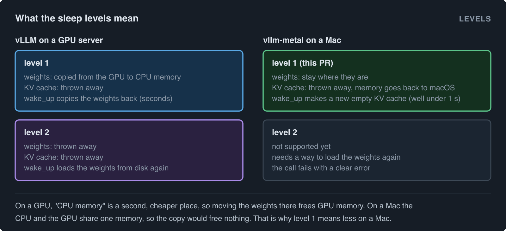
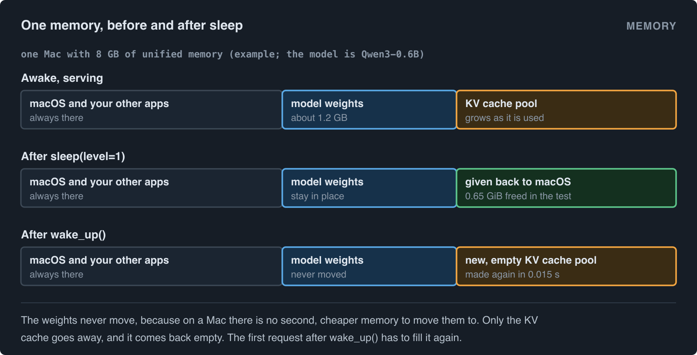
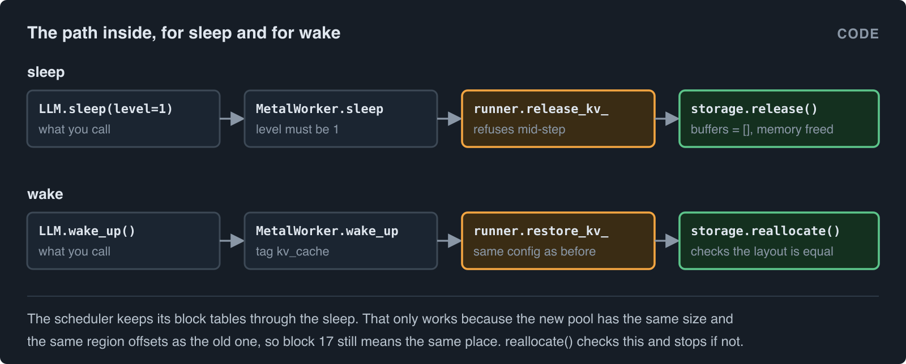

# Sleep mode on a Mac: give the KV cache back when vLLM is idle

*This article uses simple English. Each technical word gets a short explanation in brackets the first time it occurs.*

This is the story of one change to [vllm-metal](https://github.com/vllm-project/vllm-metal), the plugin that runs vLLM on Apple Silicon: [PR #1102, "Support sleep mode level 1 on Metal"](https://github.com/vllm-project/vllm-metal/pull/1102). It is a small change in lines (about 280), but it touches an idea that is easy to get wrong on a Mac: what "free the memory" can even mean when the CPU and the GPU share the same memory.

If you have never read about vllm-metal, the [guide from zero](../vllm-metal/) explains unified memory and the KV cache with pictures. This article only needs the short version of each, and gives it below.

## Contents

1. [The story](#the-story)
2. [Two words you need](#two-words-you-need)
3. [What is sleep mode in vLLM?](#what-is-sleep-mode-in-vllm)
4. [Why a Mac is different](#why-a-mac-is-different)
5. [Before and after](#before-and-after)
6. [What the numbers say](#what-the-numbers-say)
7. [How it works inside](#how-it-works-inside)
8. [What it cannot do yet](#what-it-cannot-do-yet)
9. [How to use it](#how-to-use-it)
10. [Remember](#remember)

## The story

Alice has a Mac mini with 16 GB of memory. She keeps a small model server open all day, because her editor and a few scripts send it questions. Between questions the server sits idle, but it still holds all the memory it took at startup.

In the afternoon she opens a video project. The Mac starts to swap (swap: move memory to the disk because the memory is full). Everything gets slow. Her choices were:

- Kill the server, and start it again later. Startup takes a while, and she forgets to do it.
- Start the server with a smaller memory budget. Then it is too small for her longest prompts.

Sleep mode is the third choice. The server stays open, and gives back the part of its memory it does not need while idle. When the next question comes, it takes the memory again in a fraction of a second. On a shared GPU server this feature is nice to have. On a laptop or a Mac mini, where the model shares one memory with every other app, it is the difference between "I can keep a model server open" and "I cannot".

## Two words you need

**Unified memory.** On an Apple Silicon Mac, the CPU and the GPU use the same memory chips. There is no separate "GPU memory" and "CPU memory". A model loaded for the GPU takes the same memory your browser would take. This is the one fact that changes everything below.

**KV cache.** While a model answers, it keeps notes about every token it has seen so far (the keys and values of attention, hence KV). vLLM keeps these notes in a big pool of memory, cut into fixed-size blocks, and hands out blocks to requests as they grow. The pool is set at startup from `--gpu-memory-utilization`, and it is usually the largest single thing the engine holds after the weights. The notes are only useful for the request they belong to. After the request ends, they are kept only in case the same prompt comes again (prefix caching).

So an idle engine holds two big things: the weights, which it needs to answer anything, and the KV pool, which is empty notes.

## What is sleep mode in vLLM?

vLLM has a feature called [sleep mode](https://docs.vllm.ai/en/latest/features/sleep_mode.html). You start the engine with `--enable-sleep-mode`, and later you can call `sleep()` and `wake_up()`. It has two levels:

- **Level 1**: copy the weights from the GPU to CPU memory, and throw the KV cache away. The GPU is now free for something else. `wake_up()` copies the weights back, which takes a few seconds, and makes a new KV cache.
- **Level 2**: throw away the weights too. `wake_up()` has to load them from disk again.

It was built for GPU servers that take turns: for example a training loop that uses the GPU for a while, then wakes the inference engine to generate samples, then puts it back to sleep.

## Why a Mac is different

Read level 1 again: "copy the weights from the GPU to CPU memory". On a Mac that copy frees nothing. The weights would go from one place in unified memory to another place in the same unified memory, and the Mac would hold two copies for a moment, then one, exactly as before.

So on a Mac, level 1 can only mean one useful thing: throw the KV cache away and keep the weights where they are. That is what this PR does. Because the word "level 1" now means something different from the vLLM docs, the PR adds a table to `docs/configuration.md` so that a user who knows the upstream feature sees the difference before relying on it.



Level 2 is not in this PR. It needs a way to load the weights again after they are gone, and that comes as a follow-up.

## Before and after

**Before** the change, vllm-metal's platform class did not tell vLLM that sleep mode exists, so vLLM refused at startup:

```
$ python -c 'from vllm import LLM; LLM("Qwen/Qwen3-0.6B", enable_sleep_mode=True)'
pydantic_core._pydantic_core.ValidationError: 1 validation error for ModelConfig
  Value error, Sleep mode is not supported on current platform.
```

And even if you got past that, the worker's `sleep()` and `wake_up()` only wrote a warning to the log and did nothing.

**After** the change, the same line starts the engine. You can then put it to sleep and wake it:

```python
from vllm import LLM

llm = LLM("Qwen/Qwen3-0.6B", enable_sleep_mode=True)
print(llm.generate("The capital of France is")[0].outputs[0].text)

llm.sleep(level=1)     # the KV cache is gone; the weights stay
# ... the memory is free for other work ...
llm.wake_up()          # a new, empty KV cache, in well under a second

print(llm.generate("The capital of France is")[0].outputs[0].text)   # same answer
```

The log tells you what happened:

```
INFO Sleep mode freed 0.65 GiB; <n> GiB of Metal memory is still in use.
```

The first number is what you got back. The second number is mostly the weights. That is the part a Mac cannot give back without a level 2.



## What the numbers say

Measured on an M1 MacBook Air with 8 GB, with `gpu_memory_utilization=0.5`. The footprint is the physical memory of the engine process, read 3 seconds after each call, because macOS reports freed pages with a short delay. The outputs after waking are compared, token by token, with the outputs before the first sleep.

| Model | Awake | After `sleep(1)` | Freed | `wake_up()` | Outputs after wake |
|---|---|---|---|---|---|
| `Qwen/Qwen3-0.6B` (dense) | 2.46 GiB | 1.81 GiB | 0.65 GiB | 0.015 s | identical |
| `LiquidAI/LFM2-350M` (hybrid) | 3.23 GiB | 1.23 GiB | 2.00 GiB | 0.12 s | identical |

Three things to notice.

**The freed amount is the part of the pool that was in use.** vllm-metal allocates the KV pool lazily (lazily: the memory is reserved, but a page only becomes real when something is written to it). So after three short prompts, most of the pool was never touched, and there was nothing to give back for those pages. A server that has answered long prompts all morning frees much more.

**Waking up is almost free.** There are no weights to copy. `wake_up()` only has to make a new pool, and the pool is lazy, so it costs almost nothing until it is used. The one real cost is hidden: the prefix cache starts empty, so the first request after waking has to compute its prompt from scratch.

**The answers do not change.** This is the test that matters. Sleep throws away notes, and wake makes a clean pool. If anything old leaked into the new pool, the outputs would differ. They did not, for a dense model and for a hybrid one (hybrid: a model that mixes attention layers with recurrent layers, which keep a different kind of state; more on that below).

## How it works inside

The whole change is a chain of six calls, going down from the API to the piece of code that owns the memory. The figure shows it, and the code below follows it.



### The platform says yes

vLLM asks the platform one question at startup. `vllm_metal/platform.py`:

```python
@classmethod
def is_sleep_mode_available(cls) -> bool:
    return True
```

That one method is what turns the "not supported on current platform" error off. Every other line in the PR exists so that this `True` is not a lie.

### The worker takes the call

vLLM's engine talks to a worker process, and the worker on Metal is `MetalWorker`. Its `sleep()` and `wake_up()` used to be the two warnings. Now, in `vllm_metal/v1/worker.py`:

```python
def sleep(self, level: int = 1) -> None:
    if level != 1:
        raise NotImplementedError(f"Metal supports sleep level 1 only, got {level}.")
    self.discard(("kv_cache",))

def wake_up(self, tags: list[str] | None = None) -> None:
    if tags is None or "kv_cache" in tags:
        self.model_runner.restore_kv_cache_memory()

def discard(self, tags: tuple[str, ...]) -> None:
    if set(tags) != {"kv_cache"}:
        raise NotImplementedError(f"Metal can only discard the KV cache, got tags {tags}.")
    before = mx.get_active_memory()
    self.model_runner.release_kv_cache_memory()
    gc.collect()
    mx.clear_cache()
    logger.info("Sleep mode freed %.2f GiB; %.2f GiB of Metal memory is still in use.",
                (before - mx.get_active_memory()) / (1 << 30),
                mx.get_active_memory() / (1 << 30))
```

**Read it in plain words:**

- `sleep` accepts level 1 only, and then does the same thing as "discard the KV cache". vLLM has a separate call for that, `release_kv_cache_memory()`, which also lands here. Both paths end in `discard`.
- `wake_up` takes a list of tags. vLLM uses `"weights"` and `"kv_cache"`. On Metal the weights never left, so only the `"kv_cache"` tag does anything. `wake_up(tags=["weights"])` is accepted and does nothing, which is the correct answer.
- `discard` measures the memory before, asks the model runner to release the pool, and then does two cleanups: `gc.collect()` makes Python drop objects that nothing points to, and `mx.clear_cache()` makes MLX (the array library that does the GPU work) give its own spare buffers back to the system. Without these two lines the memory would be "free" inside the process but still counted against you by macOS.
- The log line is the difference, so you can see what you got.

### The runner refuses to do it mid-step

`vllm_metal/v1/model_runner.py`:

```python
def release_kv_cache_memory(self) -> None:
    if self._execute_model_state is not None or self._decode_pipeline.has_pending:
        raise RuntimeError("Cannot release the KV cache while a step is in flight.")
    if self._paged_attention_runtime is not None:
        self._paged_attention_runtime.release_kv_memory()

def restore_kv_cache_memory(self) -> None:
    if self._paged_attention_runtime is not None:
        self._paged_attention_runtime.restore_kv_memory()
```

**Read it in plain words:** vllm-metal can have a step half done, because its decode pipeline overlaps work between steps. Freeing the notes under a step that is still writing them would be a silent corruption. So the runner checks first and refuses. In normal use this never fires, because vLLM only calls sleep when the engine is idle, but the check means a wrong call fails loudly instead of quietly.

### The runtime knows what kind of cache it has

A "runtime" in vllm-metal is the object that owns the attention code and the cache for one kind of model. There is one for plain dense models (`sdpa.py`) and one for hybrid models (`hybrid.py`). The base class in `vllm_metal/attention/runtime/base.py` says "no" by default:

```python
def release_kv_memory(self) -> None:
    raise NotImplementedError(f"Sleep mode does not support the {type(self).__name__} KV cache.")
```

The dense runtime says yes only when its cache is the shared storage:

```python
def release_kv_memory(self) -> None:
    if self._storage is None:
        # Count-initialized caches (draft-model speculation) own their arrays.
        super().release_kv_memory()
    self.storage.release()
```

And the hybrid runtime does one extra thing before it releases:

```python
def release_kv_memory(self) -> None:
    self.state_manager.discard_pending_state()
    self.storage.release()
```

**Read it in plain words:** a hybrid model has recurrent layers. Their state (a small array for each request, for each layer) lives in the same storage as the KV blocks, and the runtime updates that state lazily: it keeps a list of "pending" updates and applies them later. If you throw the storage away but keep the pending list, then after waking, the runtime would apply stale updates into a fresh pool. The PR adds `discard_pending_state()` so the pending list is emptied with the pool. There is a test that fails if that line is removed.

### The storage frees and re-creates the memory

The last stop is `KVCacheStorage` in `vllm_metal/attention/caches/storage.py`. This object holds the real MLX buffers of the pool. The PR moves the allocation into a `_bind()` method so that it can be run twice, and adds:

```python
def release(self) -> None:
    """Free the backing memory. Its contents are discarded."""
    self.tensors = {}
    self.buffers = []

def reallocate(self) -> None:
    """Re-create the backing memory with the layout vLLM scheduled against."""
    nbytes, region_offsets = self.nbytes, self.region_offsets
    self._bind()
    if (self.nbytes, self.region_offsets) != (nbytes, region_offsets):
        raise RuntimeError("Reallocated KV cache changed its layout")
```

**Read it in plain words:**

- `release` drops the two references that hold the buffers alive. MLX frees them when nothing points at them any more. The pool is gone.
- `reallocate` calls `_bind()` again with the same config, which makes a new pool. Then it checks that the new pool has exactly the same size and the same region offsets (region offsets: where each layer's part of the pool starts) as the old one.

Why is that check the whole point? Because the vLLM scheduler, which lives in another process, never heard about the sleep. It still holds its block tables (block table: the list that says "request A uses blocks 3, 17 and 40"). The attention layers still hold their views into the pool. All of that stays valid only if block 17 after waking is at the same place as block 17 before. The views read the backing buffers lazily, so they pick up the new buffers by themselves. If the layout were different, `reallocate` stops the engine instead of letting it read the wrong memory.

## What it cannot do yet

Each of these fails at startup or at the call, with an error that says why.

- **Level 2.** `sleep(level=2)` returns `Metal supports sleep level 1 only, got 2.` Dropping the weights needs a reload path.
- **Caches that are not the shared storage.** A draft model for speculative decoding (speculative decoding: a small model guesses a few tokens, the big model checks them) owns its own cache arrays. So with sleep mode on, only the `ngram` method is allowed. Standalone MLA models are also out for the same reason.
- **The PyTorch MPS backend** (`VLLM_METAL_BACKEND=mps`). Its runner has no shared KV storage to release, so sleep mode is rejected at config time.

## How to use it

From Python, as above: `LLM(..., enable_sleep_mode=True)`, then `llm.sleep(level=1)` and `llm.wake_up()`.

As a server:

```
$ VLLM_SERVER_DEV_MODE=1 vllm serve Qwen/Qwen3-0.6B --enable-sleep-mode

$ curl -X POST 'http://localhost:8000/sleep?level=1'
$ curl 'http://localhost:8000/is_sleeping'
{"is_sleeping":true}
$ curl -X POST 'http://localhost:8000/wake_up'
```

`VLLM_SERVER_DEV_MODE=1` is needed because vLLM keeps the `/sleep`, `/wake_up` and `/is_sleeping` endpoints behind that flag.

Two things to plan for:

- The prefix cache starts empty after every wake. If your app sends the same long system prompt each time, the first answer after waking is slower by the time it takes to prefill that prompt.
- How much you get back depends on how much of the pool was used. An engine that has only answered short prompts has little to give.

## Remember

On a Mac the CPU and the GPU share one memory, so "move the weights to the CPU" frees nothing. Sleep mode on Metal therefore keeps the weights and gives back only the KV cache. That is still the right thing: the KV cache is the big, empty part of an idle engine. Waking costs almost nothing because the new pool is lazy, and the scheduler never notices, because the new pool has the same layout as the old one. The check that enforces that layout is the most important line in the PR.
