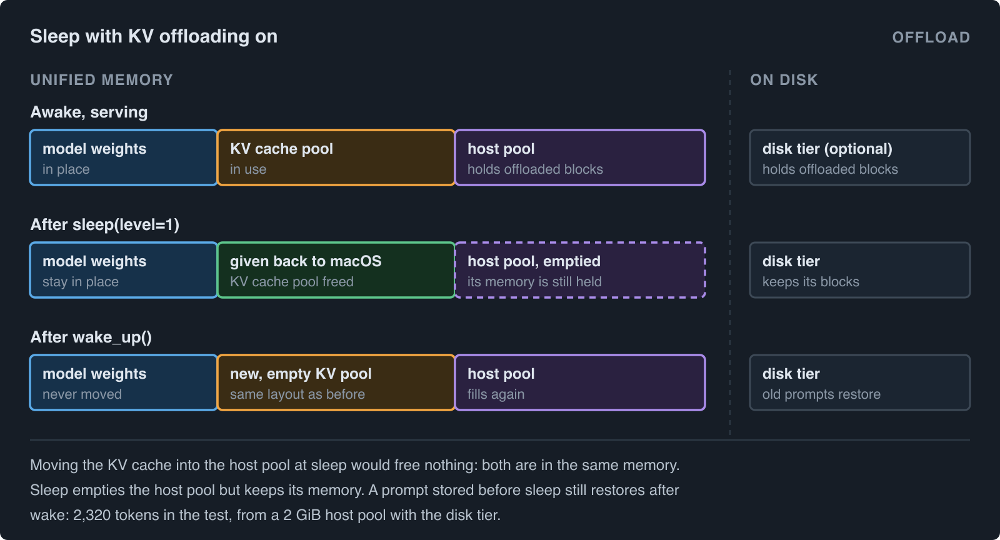

# Sleep mode on a Mac: give the KV cache back when vLLM is idle

  
Someone has a Mac mini with 16 GB of memory. They keeps a small model server open all day, because their editor and a few scripts send it questions. Between questions the server sits idle, but it still holds all the memory it took at startup.

In the afternoon they opens a video project. The Mac starts to swap (swap: move memory to the disk because the memory is full). Everything gets slow. Their choices were

- Kill the server and start it again later. Startup takes a while.
- Start the server with a smaller memory budget. Then it is too small for their longest prompts.
- Sleep mode

The server stays open and gives back the part of its memory which it does not need anymore when it's idle. When the next question comes, it takes the memory again in a fraction of a second.

## Unified Memory in Apple Mac

On an Apple Silicon Mac, the CPU and the GPU use the same memory chips. There is no separate "GPU memory" and "CPU memory". A model loaded for the GPU takes the same memory your browser would take.

While a model answers, it keeps notes about every token it has seen so far (the keys and values of attention, hence KV). vLLM keeps these notes in a big pool of memory, cut into fixed-size blocks, and hands out blocks to requests as they grow. The pool is set at startup from `--gpu-memory-utilization`, and it is usually the largest single thing the engine holds after the weights. The notes are only useful for the request they belong to. After the request ends, they are kept only in case the same prompt comes again (prefix caching).

So an idle engine holds two big things: the weights, which it needs to answer anything, and the KV pool, which is empty notes.

## **What is sleep mode in vLLM?**

vLLM has a feature called [sleep mode](https://docs.vllm.ai/en/latest/features/sleep_mode.html). You start the engine with `--enable-sleep-mode`, and later you can call `sleep()` and `wake_up()`. It has two levels:

- **Level 1**: copy the weights from the GPU to CPU memory, and throw the KV cache away. The GPU is now free for something else. `wake_up()` copies the weights back, which takes a few seconds, and makes a new KV cache.
- **Level 2**: throw away the weights too. `wake_up()` has to load them from disk again.

It was built for GPU servers that take turns: for example a training loop that uses the GPU for a while, then wakes the inference engine to generate samples, then puts it back to sleep.

## **Why a Mac (and therefore VLLM-Metal) is different**

We mentioned in the previous section about copying weights from GPU to CPU memory. But a Mac owns a single unified memory, so weights have nowhere to go.

So on a Mac, level 1 can only mean one useful thing: throw the KV cache away and keep the weights where they are. That is what vllm-metal does.


## **How it works inside**

The scheduler, which lives in another process, never hears about the sleep. It still holds its block tables: "request A uses blocks 3, 17 and 40". The attention layers still hold their views into the pool. So the one rule is: the pool that comes back after `wake_up()` must have the same layout as the pool that went away, so that block 17 still means the same place.

The object that owns the memory, `KVCacheStorage`, does exactly that:

```
def release(self) -> None:
    """Free the backing memory. Its contents are discarded."""
    self.tensors = {}
    self.buffers = []

def reallocate(self) -> None:
    """Re-create the backing memory with the layout vLLM scheduled against."""
    nbytes, region_offsets = self.nbytes, self.region_offsets
    self._bind()
    if (self.nbytes, self.region_offsets) != (nbytes, region_offsets):
        raise RuntimeError("Reallocated KV cache changed its layout")
```

`release` drops the references, and MLX frees the buffers. `reallocate` runs the same allocation code again, from the same config, and then checks that the size and the region offsets (where each layer's part of the pool starts) are what they were. The views read the backing buffers lazily, so they pick up the new buffers by themselves. If the layout changed, the engine stops instead of reading the wrong memory.

Two details around it:

- The model runner refuses to release while a step is in flight. vllm-metal overlaps work between decode steps, and freeing the notes under a step that is still writing them would be a silent corruption.
- Hybrid models (attention layers mixed with recurrent layers) keep a list of pending state updates that are applied lazily. That list is emptied together with the pool. Otherwise the first step after waking would write stale state into the fresh pool.

After the release, the worker calls `gc.collect()` and `mx.clear_cache()`, so that the memory is free for macOS and not only free inside the process, and logs the difference:

```
INFO Sleep mode freed 0.65 GiB; <n> GiB of Metal memory is still in use.
```

## **What about KV cache offloading?**

vllm-metal can also offload the KV cache. Blocks that leave the KV pool are copied to a host pool (a second area of memory, sized with `--kv-offloading-size`), and optionally to a folder on disk (the disk tier). When the same prompt comes again, the blocks are copied back, so the prompt does not have to be read again.

So why not move the KV cache into the host pool at sleep? On a Mac that frees nothing. The host pool and the KV pool live in the same unified memory, so the copy only moves the notes from one place to another.

Here is what happens when you sleep with offloading on:

- Sleep mode and offloading work together. The server starts with both flags, and `/sleep` and `/wake_up` work as usual.
- At sleep, vLLM resets the offloading connector. The host pool is emptied, and the disk tier keeps its blocks.
- The host pool keeps its memory. It is empty, but it is still allocated. Freeing it at sleep and allocating it again at wake is a planned follow-up.
- After wake, a prompt that was stored before sleep still restores. In a test with Qwen3-0.6B, a 2 GiB host pool and the disk tier, one prompt restored 2,320 tokens after wake, and the output matched a normal prefix cache hit.



## **Try it**

```
from vllm import LLM

llm = LLM("Qwen/Qwen3-0.6B", enable_sleep_mode=True)
llm.generate("The capital of France is")

llm.sleep(level=1)     # the KV cache is gone; the weights stay
llm.wake_up()          # a new, empty KV cache, in well under a second
```

As a server, the endpoints are behind vLLM's dev-mode flag:

```
$ VLLM_SERVER_DEV_MODE=1 vllm serve Qwen/Qwen3-0.6B --enable-sleep-mode
$ curl -X POST 'http://localhost:8000/sleep?level=1'
$ curl -X POST 'http://localhost:8000/wake_up'
```

With KV offloading on as well, add a host pool size in GiB:

```
$ VLLM_SERVER_DEV_MODE=1 vllm serve Qwen/Qwen3-0.6B --enable-sleep-mode --kv-offloading-size 2
```

The [KV offloading docs](https://github.com/vllm-project/vllm-metal/blob/main/docs/kv_offloading.md) show how to add the disk tier.


## Summary

On a Mac there is no second memory to move the weights to, so sleep mode keeps the weights and gives back only the KV cache. Waking is almost free because the new pool is lazy, and the scheduler never notices because the new pool has the same layout as the old one.
