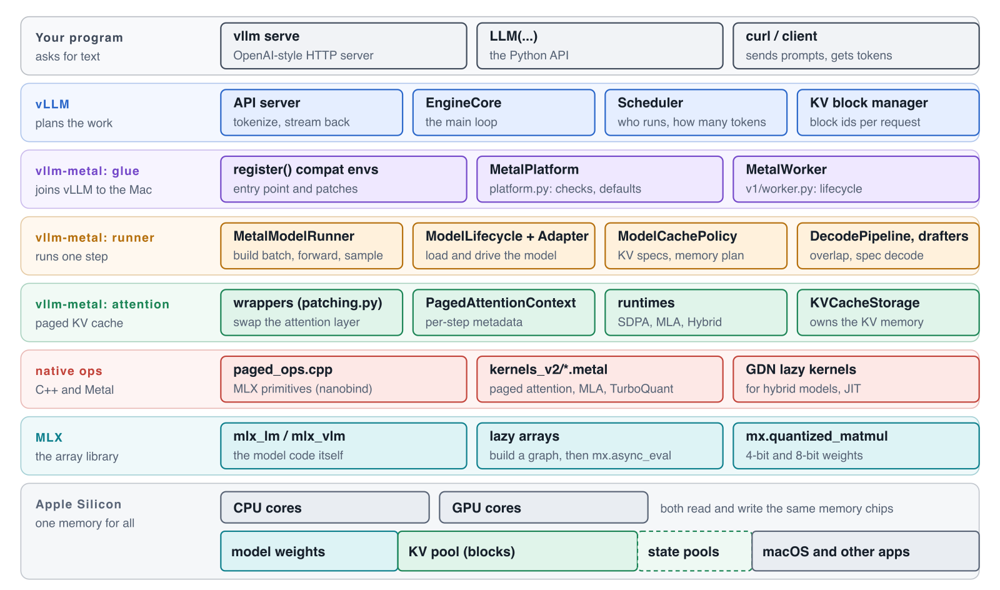
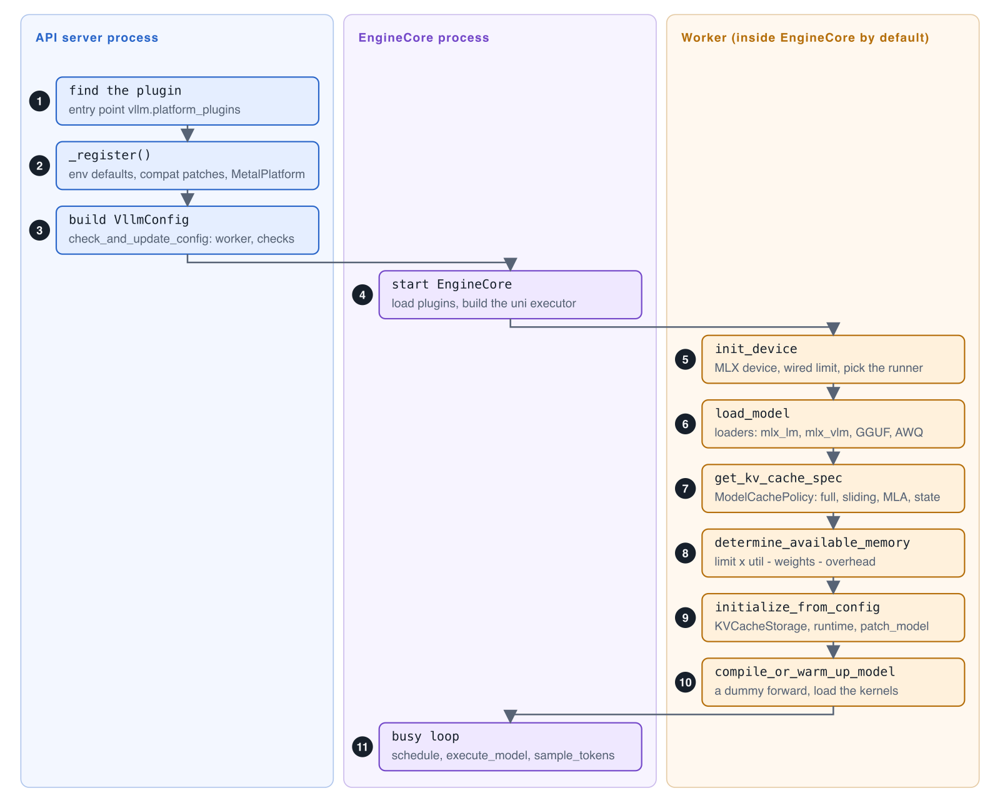
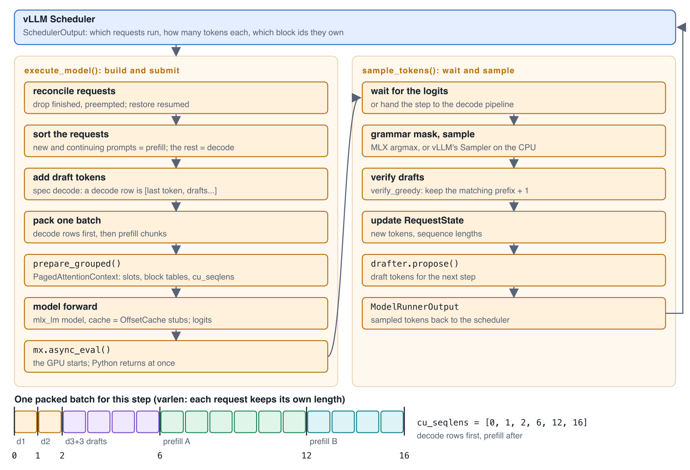
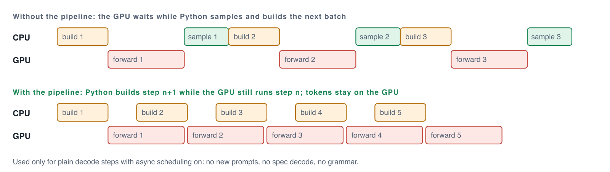
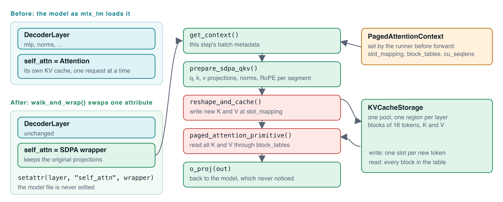
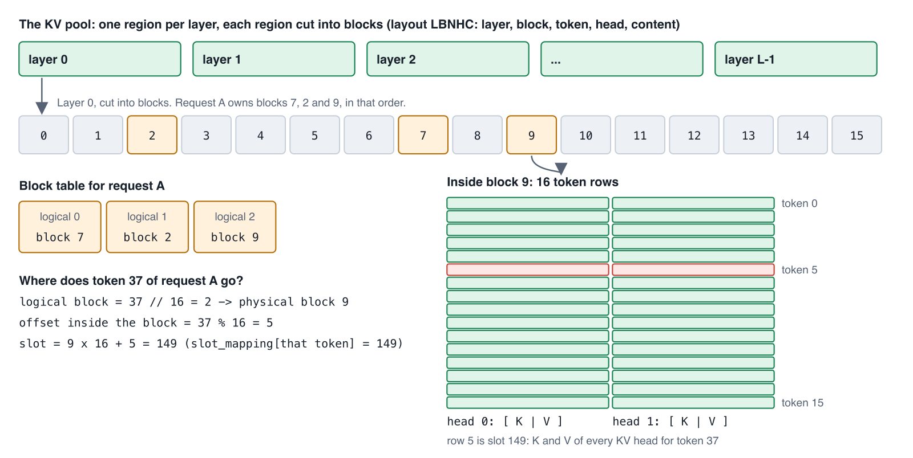
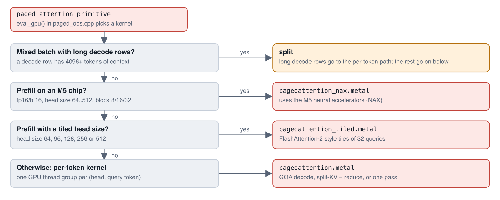
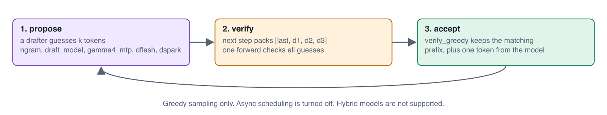
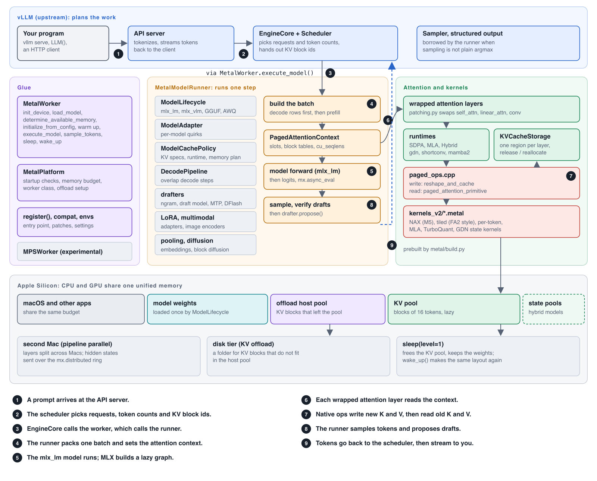

# The vllm-metal codebase, mapped

[vllm-metal](https://github.com/vllm-project/vllm-metal) is a plugin that runs vLLM on Apple Silicon. vLLM keeps the planning: which requests run, how many tokens each one gets, and which memory blocks hold their KV cache. vllm-metal does the work on the Mac: it loads the model with MLX, runs the forward pass, and reads and writes the KV cache with its own Metal kernels.

This guide walks through the code. It was written against commit [`42e4b2a`](https://github.com/vllm-project/vllm-metal/tree/42e4b2a313a61406dacbf3723bd4571812eaff47) (14 Oct 2026), about 47,000 lines of Python, C++ and Metal. Every file link opens that exact commit. If you want the ideas first (unified memory, the paged KV cache) without the code, start with [vLLM on a Mac: vllm-metal explained from zero](../vllm-metal/).

## Contents

1. [The story](#the-story)
2. [Words you need](#words-you-need)
3. [The layers](#the-layers)
4. [Where things live](#where-things-live)
5. [Startup: from vllm serve to ready](#startup-from-vllm-serve-to-ready)
6. [One engine step](#one-engine-step)
7. [The decode pipeline](#the-decode-pipeline)
8. [How attention plugs in](#how-attention-plugs-in)
9. [The KV cache in memory](#the-kv-cache-in-memory)
10. [The Metal kernels](#the-metal-kernels)
11. [Different model shapes](#different-model-shapes)
12. [Features that hook in](#features-that-hook-in)
13. [Settings worth knowing](#settings-worth-knowing)
14. [The whole picture](#the-whole-picture)
15. [Where to start reading](#where-to-start-reading)

## The story

Think of a busy restaurant. **vLLM** is the head waiter. It has the seating chart: which guests sit now, which wait, and which table each guest has. It does not cook.

**vllm-metal** is the kitchen. Each time the head waiter sends an order slip (a *step*), the kitchen cooks every dish on the slip in one go and sends the plates back.

**MLX** is the stove and the pans, Apple's array library. **The Metal kernels** are a few special knives that the kitchen made for one hard job: reading the KV cache in pieces.

On a Mac, the kitchen and the dining room share one room: the **unified memory**. Every byte the kitchen takes is a byte the rest of the Mac cannot use. A lot of the code exists because of this one fact.

## Words you need

| Word | Meaning |
|---|---|
| Plugin | A package that vLLM finds through a Python entry point and loads at startup. vLLM's code stays unchanged. |
| MLX, mlx_lm, mlx_vlm | MLX is Apple's array library for the Mac GPU. mlx_lm and mlx_vlm hold the model code (Llama, Qwen, Gemma, vision models) written in MLX. |
| Lazy evaluation | MLX first records the math as a graph. The GPU does the work only when you ask for a result (`mx.eval`), or starts it in the background (`mx.async_eval`). |
| KV cache | Notes the model keeps for every token it has seen: one key and one value vector, for each layer and each KV head. |
| Block, block table | The KV cache is cut into blocks of 16 tokens. A block table is a request's list of blocks, in order, for example [7, 2, 9]. |
| Prefill, decode | Prefill reads the prompt, many tokens at once. Decode makes one new token per step. |
| Varlen batch | One batch where each request has its own length, packed side by side. `cu_seqlens` (cumulative sequence lengths) marks where each request starts. |
| Metal kernel | A small program that runs on the Apple GPU, written in Metal Shading Language (`.metal` files). |

## The layers

Read the diagram from top to bottom. Each layer only talks to the layer under it. vLLM never imports MLX. The model code in mlx_lm never knows that a paged KV cache exists.



Colors stay the same in every diagram: blue is vLLM, violet is the glue, amber is the runner, green is attention, red is native code, teal is MLX.

**Read it in plain words:**

- **vLLM** decides *what* to run. Its scheduler and KV block manager are used as they are.
- **The glue** tells vLLM "this machine is a Metal platform" and answers its questions: how much memory, which worker class, which features work.
- **The runner** turns one order slip from the scheduler into one forward pass and a list of sampled tokens.
- **Attention** is where vllm-metal does its most special work: a paged KV cache shared by all requests.
- **Native ops** are C++ and Metal code that MLX does not provide, such as reading K and V through a block table.

## Where things live

Everything is under `vllm_metal/`.

**Glue**

- `__init__.py`: the entry point `register()`, env defaults
- `platform.py`: MetalPlatform, startup checks and defaults
- `compat.py`, `patches/`: small fixes to vLLM, transformers and mlx_lm
- `envs.py`, `config.py`: the `VLLM_METAL_*` settings
- `v1/worker.py`: MetalWorker, the methods vLLM calls

**Runner (`v1/`)**

- `model_runner.py`: MetalModelRunner, the biggest file (3,245 lines)
- `model_lifecycle.py`: loads the model
- `model_adapter.py`: per-model quirks behind one interface
- `cache_policy.py`: KV specs, runtime choice, memory budget
- `decode_pipeline.py`, `sampling_batch.py`: overlap and sampling
- `spec_decode.py` and the proposers: ngram, draft model, Gemma 4 MTP, DFlash, DSpark
- `kv_offload/`, `lora/`, `mm/`, `pooling/`, `diffusion.py`: features

**Attention**

- `attention/patching.py`: swaps the attention layers
- `attention/context.py`: the per-step metadata
- `attention/runtime/`: SDPA, MLA and Hybrid runtimes, model families
- `attention/impls/`: the forward code for each layer kind
- `attention/caches/`: KVCacheStorage, state cache, TurboQuant
- `attention/state/`: state alignment for hybrid models

**Native code**

- `metal/paged_ops.cpp`: MLX primitives, bound with nanobind
- `metal/kernels_v2/*.metal`: paged attention, NAX, MLA, TurboQuant, GDN
- `metal/build.py`: builds the `.so` and the `.metallib` files

**Model sources**

- `gguf/`: GGUF files (experimental)
- `quant/`: AWQ checkpoints
- `multimodal/`: Gemma 4, Qwen3-VL, PaddleOCR-VL
- `stt/`: speech to text, Whisper and Qwen3-ASR
- `spec_decode/gemma4/`: the Gemma 4 MTP helper model

**Other**

- `distributed/`: pipeline parallel across Macs
- `pytorch_backend/`: an experimental PyTorch MPS backend
- `profiler/`: Metal frame capture for Xcode
- `tensor_bridge.py`: MLX to torch and back, with DLPack

## Startup: from vllm serve to ready

Three places run code: the API server process, the EngineCore process, and the worker. By default the executor is `uni`, so the worker lives inside the EngineCore process. Follow the numbers.



**Read it in plain words:**

- **Steps 1 to 3.** vLLM finds the plugin through the entry point in `pyproject.toml` ([`pyproject.toml:98`](https://github.com/vllm-project/vllm-metal/blob/42e4b2a313a61406dacbf3723bd4571812eaff47/pyproject.toml#L98)). `_register()` ([`vllm_metal/__init__.py:140`](https://github.com/vllm-project/vllm-metal/blob/42e4b2a313a61406dacbf3723bd4571812eaff47/vllm_metal/__init__.py#L140)) sets env defaults, applies the compat patches and returns the platform class. Then `check_and_update_config` ([`vllm_metal/platform.py:505`](https://github.com/vllm-project/vllm-metal/blob/42e4b2a313a61406dacbf3723bd4571812eaff47/vllm_metal/platform.py#L505)) runs about 18 checks. Any feature mix that cannot work on a Mac (for example tensor parallel, or spec decode with async scheduling) fails here, before the model loads.
- **Steps 5 and 6.** The worker sets up MLX ([`vllm_metal/v1/worker.py:129`](https://github.com/vllm-project/vllm-metal/blob/42e4b2a313a61406dacbf3723bd4571812eaff47/vllm_metal/v1/worker.py#L129)) and loads the model ([`vllm_metal/v1/model_lifecycle.py:185`](https://github.com/vllm-project/vllm-metal/blob/42e4b2a313a61406dacbf3723bd4571812eaff47/vllm_metal/v1/model_lifecycle.py#L185)). The loader tries GGUF, then a vision model (mlx_vlm), then AWQ, then plain mlx_lm.
- **Step 8.** The KV budget is `max working set x --gpu-memory-utilization - weights - overhead` ([`vllm_metal/v1/cache_policy.py:1175`](https://github.com/vllm-project/vllm-metal/blob/42e4b2a313a61406dacbf3723bd4571812eaff47/vllm_metal/v1/cache_policy.py#L1175)). On a Mac, "GPU memory" is the same memory as everything else, so this number is a share of the whole machine.
- **Step 9.** The KV pool is created, the right runtime is built, and the model's attention layers are wrapped ([`vllm_metal/v1/cache_policy.py:650`](https://github.com/vllm-project/vllm-metal/blob/42e4b2a313a61406dacbf3723bd4571812eaff47/vllm_metal/v1/cache_policy.py#L650)).

## One engine step

Every step, the scheduler sends one order slip: a `SchedulerOutput`. The runner answers in two calls. `execute_model` builds the batch and starts the GPU. `sample_tokens` waits for the result and picks the tokens. The split lets vLLM's scheduler plan the next step while the GPU is busy.



**Read it in plain words:**

- The whole step is one forward pass for all requests together: a few decode rows and some prefill chunks, packed side by side ([`_start_paged_forward`](https://github.com/vllm-project/vllm-metal/blob/42e4b2a313a61406dacbf3723bd4571812eaff47/vllm_metal/v1/model_runner.py#L1355)).
- The packing order is decode rows first, then prefill. `cu_seqlens` tells every kernel where each request starts. In the example, token 8 belongs to prefill A, because 6 ≤ 8 < 12.
- The model is called with stub caches (`OffsetCache`), so mlx_lm thinks it runs one plain sequence. The real KV cache is reached through the attention context, set by `prepare_grouped` ([`vllm_metal/attention/context.py:216`](https://github.com/vllm-project/vllm-metal/blob/42e4b2a313a61406dacbf3723bd4571812eaff47/vllm_metal/attention/context.py#L216)).
- Only the rows that need a token are turned into logits: every decode row, and the last row of each finished prefill. This saves a large matrix multiply for long prompts.
- Plain greedy sampling stays in MLX. Anything else (top-p, penalties, seeds) goes to vLLM's own Sampler on the CPU ([`vllm_metal/v1/sampling_batch.py:628`](https://github.com/vllm-project/vllm-metal/blob/42e4b2a313a61406dacbf3723bd4571812eaff47/vllm_metal/v1/sampling_batch.py#L628)).

## The decode pipeline

In a plain decode step, the GPU work is small and Python's work around it is not. If Python waits for each token before it builds the next batch, the GPU sits idle. The decode pipeline ([`vllm_metal/v1/decode_pipeline.py:67`](https://github.com/vllm-project/vllm-metal/blob/42e4b2a313a61406dacbf3723bd4571812eaff47/vllm_metal/v1/decode_pipeline.py#L67)) removes that wait: the sampled tokens stay on the GPU as lazy arrays, and the next forward reads them from there.



## How attention plugs in

mlx_lm models expect a simple KV cache: one growing array per request. vLLM needs a paged cache shared by all requests. vllm-metal joins the two without editing a single model file. At startup, `walk_and_wrap` ([`vllm_metal/attention/patching.py:60`](https://github.com/vllm-project/vllm-metal/blob/42e4b2a313a61406dacbf3723bd4571812eaff47/vllm_metal/attention/patching.py#L60)) goes through every layer and replaces one attribute, the attention module, with a wrapper.



A simplified version of the loop:

```python
for idx, layer in enumerate(find_layers(model)):        # model.layers, or language_model.model.layers
    attr = first of ("self_attn", "linear_attn", "attention", "conv") on layer
    setattr(layer, attr, make_wrapper(getattr(layer, attr), cache, idx))
```

**Read it in plain words:**

- The wrapper keeps the original projections and norms, so the weights and the math stay the model's own.
- When it runs, it asks `get_context()` for this step's metadata. With no context set (for example in a test), it calls the original module unchanged.
- It writes the new K and V into the pool with `reshape_and_cache`, then reads every past K and V through the block tables with `paged_attention_primitive` ([`sdpa_forward`](https://github.com/vllm-project/vllm-metal/blob/42e4b2a313a61406dacbf3723bd4571812eaff47/vllm_metal/attention/impls/sdpa.py#L544)).
- Both are MLX primitives written in C++. They join MLX's lazy graph, so MLX orders the write before the read by itself.

## The KV cache in memory

vLLM's KV block manager hands out block ids. `KVCacheStorage` ([`vllm_metal/attention/caches/storage.py:115`](https://github.com/vllm-project/vllm-metal/blob/42e4b2a313a61406dacbf3723bd4571812eaff47/vllm_metal/attention/caches/storage.py#L115)) owns the memory those ids point to. vllm-metal tells vLLM that it supports one layout only: **LBNHC** (layer, block, token, head, content). Content is the key followed by the value.



**Read it in plain words:**

- Each layer gets its own region (its own Metal buffer), so the whole pool never has to fit in one buffer.
- The pool is made with `torch.empty`, which reserves memory without writing to it. macOS only commits a page when something is written. This is why a fresh server uses less memory than its budget.
- A request never sees physical addresses. It has a block table, and the runner turns each new token's position into a slot number (the `slot_mapping`).
- Sleep mode uses this object: `release()` drops the buffers, and `reallocate()` makes them again with the same layout, so block 9 still means the same place. See [Sleep mode on a Mac](../sleep-mode/).

## The Metal kernels

When MLX evaluates `paged_attention_primitive`, its `eval_gpu` ([`vllm_metal/metal/paged_ops.cpp:643`](https://github.com/vllm-project/vllm-metal/blob/42e4b2a313a61406dacbf3723bd4571812eaff47/vllm_metal/metal/paged_ops.cpp#L643)) chooses one of several kernels. The checks run in this order:



### How does a kernel find its request?

A GPU thread group starts with only a number: "you are query token 8". The kernel finds the request that owns token 8 with a binary search over `cu_seqlens` ([`find_seq_idx`](https://github.com/vllm-project/vllm-metal/blob/42e4b2a313a61406dacbf3723bd4571812eaff47/vllm_metal/metal/kernels_v2/pagedattention.metal#L622)):

```cpp
// cu_seqlens_q is sorted: [0, q_len_0, q_len_0+q_len_1, ...]
inline int find_seq_idx(const device int32_t *cu_seqlens_q, int q_token_idx, int num_seqs) {
  int lo = 0, hi = num_seqs;
  while (lo < hi) {
    int mid = (lo + hi + 1) / 2;
    if (cu_seqlens_q[mid] <= q_token_idx) lo = mid; else hi = mid - 1;
  }
  return lo;
}
```

**Read it in plain words:**

- With `cu_seqlens = [0, 1, 2, 6, 12, 16]` and token 8: the search ends at index 3, because 6 ≤ 8 < 12. Token 8 is the third token of prefill A.
- Then the kernel reads that request's block table and walks its blocks, using one online softmax (a softmax that updates as new scores come in, so it never needs all scores at once).
- The kernels ship prebuilt: a nanobind `.so` plus `.metallib` files. Set `VLLM_METAL_BUILD_FROM_SOURCE=1` to build them on your Mac ([`vllm_metal/metal/build.py`](https://github.com/vllm-project/vllm-metal/blob/42e4b2a313a61406dacbf3723bd4571812eaff47/vllm_metal/metal/build.py)).

## Different model shapes

Not every model has plain attention in every layer. `ModelCachePolicy` picks one of three runtimes ([`vllm_metal/v1/cache_policy.py:875`](https://github.com/vllm-project/vllm-metal/blob/42e4b2a313a61406dacbf3723bd4571812eaff47/vllm_metal/v1/cache_policy.py#L875)): Hybrid if the model mixes attention with recurrent layers, else MLA, else SDPA.

| Runtime | For | What the cache holds |
|---|---|---|
| `SDPA` | Most models: Llama, Qwen3, Gemma, Mistral | K and V per token, per KV head |
| `MLA` | DeepSeek-style latent attention | one compressed latent vector per token |
| `Hybrid` | attention mixed with recurrent or conv layers | KV blocks, plus state pools in the same allocation |

The Hybrid runtime has families, chosen by `model_type` ([`vllm_metal/attention/runtime/factory.py:49`](https://github.com/vllm-project/vllm-metal/blob/42e4b2a313a61406dacbf3723bd4571812eaff47/vllm_metal/attention/runtime/factory.py#L49)):

| Family | Model types | Layer that gets wrapped |
|---|---|---|
| gdn | `qwen3_next`, `qwen3_5*` | `linear_attn` (Gated DeltaNet) |
| shortconv | `lfm2`, `lfm2_moe` | `conv` |
| kda | `bailing_hybrid` | `linear_attn` |
| nemotron_h | `nemotron_h` | `mixer` (Mamba2) |
| granite | `granitemoehybrid` | `mamba` (Mamba2) |

A recurrent layer keeps one small state per request instead of one note per token. For prefix caching, the state manager ([`vllm_metal/attention/state/align.py:61`](https://github.com/vllm-project/vllm-metal/blob/42e4b2a313a61406dacbf3723bd4571812eaff47/vllm_metal/attention/state/align.py#L61)) copies the state forward into a new block each step and leaves the old block as a checkpoint.

## Features that hook in

Each feature attaches to one place in the step. Spec decode is the most involved one:



| Feature | What it does | Hooks in at |
|---|---|---|
| Speculative decoding | Five drafters share one controller. Drafts from step n are checked in step n+1 ([`verify_greedy`](https://github.com/vllm-project/vllm-metal/blob/42e4b2a313a61406dacbf3723bd4571812eaff47/vllm_metal/v1/spec_decode.py#L235)). | batch packing and the end of sampling |
| KV offloading | KV blocks that leave the pool go to a host pool in RAM, and optionally to a folder on disk. | vLLM's KV connector calls around each forward |
| Sleep mode | Level 1 frees the KV pool and keeps the weights, because on unified memory there is no cheaper place to move them. | `MetalWorker.sleep` and `KVCacheStorage.release` |
| LoRA | Linear layers are wrapped, and each token is routed to its adapter, Punica style. | `prepare_step`, before the forward |
| Multimodal | An adapter runs the vision tower, and the image embeddings are spliced into the text embeddings. | the start of the step, and the forward call |
| Embeddings and reranking | Decoder models pool inside the paged forward. Encoder models (BGE-M3) skip paged attention. | the forward, then pooling in place of sampling |
| Speech to text | Whisper and Qwen3-ASR use their own runner, with no paged KV cache. | `init_device`, which picks `STTModelRunner` |
| More than one Mac | Pipeline parallel splits the layers across Macs and sends hidden states over the MLX ring ([`vllm_metal/distributed/pipeline.py:76`](https://github.com/vllm-project/vllm-metal/blob/42e4b2a313a61406dacbf3723bd4571812eaff47/vllm_metal/distributed/pipeline.py#L76)). Data parallel runs one full copy per Mac. | `init_device` and the forward |

## Settings worth knowing

| Setting | Default | What it does |
|---|---|---|
| `--gpu-memory-utilization` | vLLM default | The share of the Mac's working set that weights plus KV may use |
| `VLLM_METAL_BACKEND` | `mlx` | `mps` selects the experimental PyTorch backend |
| `VLLM_METAL_DECODE_PIPELINE` | on | The one-step-ahead decode overlap |
| `VLLM_METAL_NATIVE_SAMPLING` | off | Sample top-p and top-k in MLX, skipping the CPU sampler |
| `VLLM_METAL_SPEC_VERIFY_WINDOW` | off | Check all drafts of a request in one window |
| `VLLM_METAL_DISABLE_NAX` | off | Emergency switch for the M5 NAX prefill kernel |
| `VLLM_METAL_BUILD_FROM_SOURCE` | off | Compile the native ops on this Mac |
| `--additional-config` | none | Turns on TurboQuant KV compression |

The full list with checks is in [`vllm_metal/envs.py:135`](https://github.com/vllm-project/vllm-metal/blob/42e4b2a313a61406dacbf3723bd4571812eaff47/vllm_metal/envs.py#L135).

## The whole picture

Everything above in one diagram. Follow the numbers for one request, from the prompt to the streamed token.



## Where to start reading

1. [`vllm_metal/__init__.py:140`](https://github.com/vllm-project/vllm-metal/blob/42e4b2a313a61406dacbf3723bd4571812eaff47/vllm_metal/__init__.py#L140): the entry point. It is short and shows what the plugin changes at import time.
2. [`vllm_metal/v1/worker.py:129`](https://github.com/vllm-project/vllm-metal/blob/42e4b2a313a61406dacbf3723bd4571812eaff47/vllm_metal/v1/worker.py#L129): the methods vLLM calls, in the order it calls them.
3. [`model_runner.py: execute_model`](https://github.com/vllm-project/vllm-metal/blob/42e4b2a313a61406dacbf3723bd4571812eaff47/vllm_metal/v1/model_runner.py#L2968), then [`_start_paged_forward`](https://github.com/vllm-project/vllm-metal/blob/42e4b2a313a61406dacbf3723bd4571812eaff47/vllm_metal/v1/model_runner.py#L1355): one step from start to end.
4. [`context.py: prepare_grouped`](https://github.com/vllm-project/vllm-metal/blob/42e4b2a313a61406dacbf3723bd4571812eaff47/vllm_metal/attention/context.py#L216): how positions become slots.
5. [`vllm_metal/attention/patching.py:60`](https://github.com/vllm-project/vllm-metal/blob/42e4b2a313a61406dacbf3723bd4571812eaff47/vllm_metal/attention/patching.py#L60) and [`vllm_metal/attention/impls/sdpa.py:544`](https://github.com/vllm-project/vllm-metal/blob/42e4b2a313a61406dacbf3723bd4571812eaff47/vllm_metal/attention/impls/sdpa.py#L544): the wrapper and what it runs.
6. [`vllm_metal/attention/caches/storage.py:115`](https://github.com/vllm-project/vllm-metal/blob/42e4b2a313a61406dacbf3723bd4571812eaff47/vllm_metal/attention/caches/storage.py#L115): who owns the memory.
7. [`vllm_metal/metal/paged_ops.cpp:643`](https://github.com/vllm-project/vllm-metal/blob/42e4b2a313a61406dacbf3723bd4571812eaff47/vllm_metal/metal/paged_ops.cpp#L643) and [`vllm_metal/metal/kernels_v2/pagedattention.metal:622`](https://github.com/vllm-project/vllm-metal/blob/42e4b2a313a61406dacbf3723bd4571812eaff47/vllm_metal/metal/kernels_v2/pagedattention.metal#L622): the kernel choice and the kernel.

**Remember.** vLLM plans, vllm-metal cooks. The runner packs every request into one varlen batch, the wrapped attention layers find the KV cache through a per-step context, and Metal kernels read it block by block. All of it shares one unified memory with the rest of the Mac.
